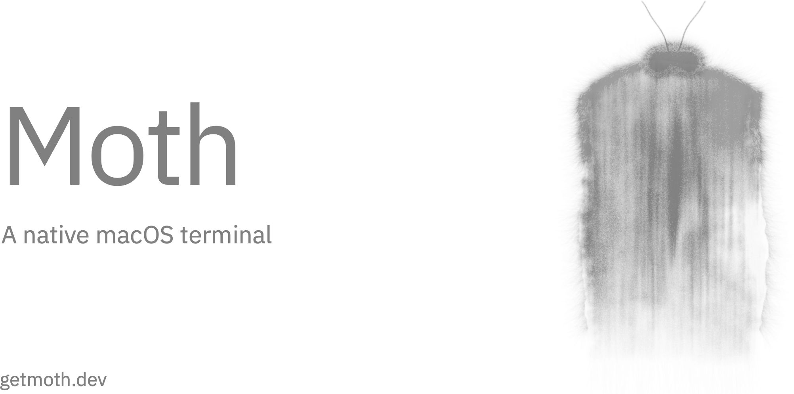

[Website](https://getmoth.dev) · [Documentation](https://getmoth.dev/docs/)

## Install

For Apple silicon Macs running macOS 13 or later.

**Recommended:** [Download the signed and notarised disk image](https://getmoth.dev/download/) from the Moth website. Open it and drag Moth to Applications.

Alternatively, if you use [Homebrew](https://brew.sh/):

```sh
brew install --cask londonpixelexchange/tap/moth
```

© 2026 T E Vaughan.


## Licence

Moth’s code and documentation are free and open source under the [GNU General Public License, version 3 or later](LICENSE) (`GPL-3.0-or-later`). You may use, modify and redistribute the code, including commercially, under the GPL’s terms. Distributed modified versions must also provide corresponding source under those terms.

Third-party components retain their own licences. The bundled Wumpus Mono Pro font files are proprietary and have [separate terms](FONT-PERMISSION). Modified forks must use a different name, icon and logo under the [Moth branding policy](TRADEMARKS).

See [NOTICE](NOTICE) and [third-party notices](THIRD-PARTY-NOTICES). Earlier releases retain the [Moth Source-Available Licence 1.0](licences/moth-source-available-1.0.txt) and their original [font permission](licences/wumpus-font-permission-1.0.txt).
